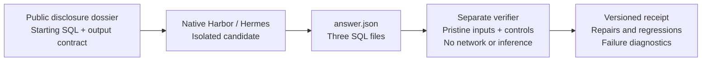

# WorkpaperBench

**Repair a financial workpaper. Preserve the calculations that were already right.**

WorkpaperBench evaluates financial research as an inspectable work product:
three SQL queries, cited source evidence, and bounded conclusions. Models update
quarterly financials, audit reserve metrics, and reconcile revenue or profit
changes. A separate verifier checks the submitted queries against original
observations and synthetic controls.

The strongest retained example is a Microsoft workpaper that **fixed missing
quarterly results but broke a correct margin calculation by 100×**. A Block
workpaper exposed the opposite problem: a valid answer rejected by the grader.
Both are preserved, with corrected scoring separated from model improvement.

[Quickstart](#quickstart) · [Run your model](docs/RUNNING.md) · [Methods](docs/WORKFLOW.md) · [Inspect a task](datasets/workflow-v7/tasks/c01/instruction.md) · [Research prerelease](https://github.com/CaoimhConway/workpaperbench/releases/tag/v0.5.0-local.4)

| Task collection | Starting point | Inspectable evidence |
| --- | --- | --- |
| **30 source-backed tasks** across three financial workflows | **61/90 queries already correct**, including controls | **3 retained development workpapers**, with original files and scoring receipts |
| 6 development, 24 evaluation cases | Every task supplies at least two valid queries | Repairs, preservation, regressions, and remaining defects reported separately |

Current catalog: **workflow-v7**, scorer **workflow-1.2.0**. This is a research
prerelease with verified references and controls. Current-version model
performance has not been measured.

## Follow the evidence

These are corrected replays of unchanged **workflow-v5** submissions from
Qwen3.6-35B-A3B UD-Q5_K_M. Each row covers three queries on original inputs **and
all controls**. Settings and budgets differed, including a continued Block
session, so these are case studies rather than a controlled model comparison.

| Retained workpaper | Repaired | Preserved | Damaged | Left incorrect | What review revealed |
| --- | ---: | ---: | ---: | ---: | --- |
| [Microsoft](reports/workflow-v5/submissions/qwen36-development-a01-5) | 1 | 1 | 1 | 0 | Added the missing quarter, then introduced a 100× basis-point error |
| [Brale](reports/workflow-v5/submissions/qwen36-development-b01-1) | 0 | 2 | 0 | 1 | Fixed original-input coverage, but identical exports still create duplicate economic-date rows |
| [Block](reports/workflow-v5/submissions/qwen36-development-c01-5) | 1 | 2 | 0 | 0 | Correct economics received credit after the grader accepted full filing labels |
| **Nine query transitions** | **2** | **5** | **1** | **1** | Scorer corrections are not model repairs |

[Corrected verdicts and artifact hashes](reports/workflow-v5/corrected-replay.json) · [Original and control-inclusive transitions](reports/local/starting-sql-baseline.md) · [Machine-readable starting baselines](reports/workflow-v7/starting-sql.json)

### One workpaper can improve and regress

[Microsoft's supplied statements](datasets/workflow-v7/tasks/a01/environment/sources.md)
give FY2025 Q1 revenue and operating income by subtracting Q2 from the half-year: USD 65,585 million and USD 30,552 million.
The sequential operating-margin change is:

```text
10,000 × (31,653 / 69,632 − 30,552 / 65,585) = −112.6274 basis points
```

The retained model first expressed margins as percentages, then multiplied their
difference by 10,000 again. It returned **−11,262.74 bps**. The starting
reconciliation query was correct, making this a preservation failure as well as
a unit error. The same submission repaired the missing-quarter query.

Brale illustrates why original inputs alone are insufficient. Its coverage query
passes the published snapshots but fails when the verifier repeats an identical
export. That is a remaining robustness defect, even though the original-input
calculation improved. A research workflow must distinguish another export from
another economic observation.

### The evaluator also has to earn its result

Block's SQL returned the filing's full revenue and cost labels. The old grader
expected shortened labels that the contract had not declared. Corrected scoring
accepts those equivalent categories while continuing to reject category swaps,
wrong units, and duplicate keys. The submitted SQL is unchanged.

The current audit found another legitimate alternative: Microsoft's supplied
segment table contains the consolidated totals needed for both quarter tables
and the margin claim. **Version 7 accepts that sufficient citation path.** The
[correction and independent calculation test](tests/test_workflow_evidence_alternative.py)
preserve every financial target, control, and historical result.

Together, these cases make the benchmark useful for evaluation engineering:
inspect the work, isolate the failure, test a counterexample, and version the
correction. A score alone cannot establish which side was wrong.

## What a run produces



| Diagnostic | Question answered |
| --- | --- |
| Repair / preservation / regression / unrepaired | How did each query change relative to the same starting task and scorer? |
| Numbers and claim verdicts | Are the calculations and bounded conclusions correct? |
| Evidence | Does each output cite a sufficient, relevant source selection? |
| Robustness | Does the SQL recompute correctly under declared kinds of input change? |
| Delivery | Were the requested, bounded JSON and SQL artifacts delivered? |
| Infrastructure | Did the harness complete with valid isolation and retained evidence? |

Reports keep unassessed outcomes explicit. A timeout without a valid delivery is
not counted as three incorrect calculations. Scoring executes SQL only in the isolated
Linux verifier, with read-only authorization and bounded memory, time, and output.

## Quickstart

For a model-free tour, use Python 3.12:

```sh
git clone https://github.com/CaoimhConway/workpaperbench.git
cd workpaperbench
git checkout v0.5.0-local.4
python3 -m venv .venv
.venv/bin/pip install -e '.[test]'
./wpb demo
./wpb validate examples/block-workpaper-v7/answer.json
```

`demo` displays the Block calculation, the 61/90 starting baseline, and retained
repair/regression diagnostics. `validate` checks structure. Neither executes
submitted SQL or calls a model.

For actual scoring, follow the [dedicated Linux guest setup](docs/RUNNING.md).
From the checkout **inside that guest**:

```sh
./wpb guest grade --task c01 --artifacts examples/block-workpaper-v7 \
  --attempt external-reference-1
./wpb guest report --attempts external-reference-1 \
  --output .local/external-reference-report.json
```

The authored example should pass every check. The report shows one repair and
two preservations against the starting SQL. Use fresh attempt IDs and output
paths. The [execution guide](docs/RUNNING.md) covers a tested native tool-call
smoke, compatible model configuration, development task selection, budgets,
outputs, and exact-artifact replay. It uses Harbor and Hermes directly, without
owner-specific Mac paths or a provider framework.

## What the benchmark measures

| Workflow | Consequential decisions | Development / evaluation |
| --- | --- | ---: |
| Update a model | Reconstruct quarters, align periods and units, preserve valid outputs | 2 / 8 |
| Audit a metric | Choose denominators, separate stocks from flows, deduplicate exports | 2 / 8 |
| Explain a change | Build signed bridges, reconcile reported totals, bound causal attribution | 2 / 8 |

These are **supplied-dossier maintenance tasks**. Source-derived observations,
clear definitions, and existing correct SQL represent assistance an analyst
could receive. They reduce extraction and search difficulty. They also create
a structural shortcut: 29 tasks have exactly one faulty starting query, and
`b04` needs no SQL repair. The [validity assessment](docs/WORKFLOW.md#validity-assessment)
explains the implications and simple claim-label baselines. No defects were
added to manufacture lower scores.

Evidence grading tests source selection, not arbitrary prose entailment.
Unresolved claims test bounded abstention, not calibrated probabilities.
Public sources and references create contamination risk, and related issuer
templates reduce independence. The 24 evaluation source groups have received
trusted reference/control validation only. Independent financial-domain review,
human agreement, external replication, and current-version model discrimination
remain pending. Finite controls do not prove correctness on every future input.

## Reproduce, inspect, improve

Run `.venv/bin/python -m pytest -q` for regression checks. The
[methods](docs/WORKFLOW.md) document reconstruction and isolated validation.
Earlier failures, timeouts, and incomplete attempts remain visible in the
[development pilot](reports/local/workflow-qwen36-development-1.json),
[recovery record](reports/local/workflow-qwen36-development-5.json), and separate
[historical hosted study](reports/challenge-v1/reviewed-results.md).

A useful contribution is a valid workpaper rejected by the grader, an independently
checked reference, or a financial counterexample. Include the task and scorer
IDs, exact submitted files, expected result, and supporting source. Corrections
receive new identities rather than overwriting old results.

Code: [MIT](LICENSE). [Source rights and provenance](DATA_SOURCES.md) distinguish
public observations, authored defects, synthetic controls, references, and actual
submissions.
